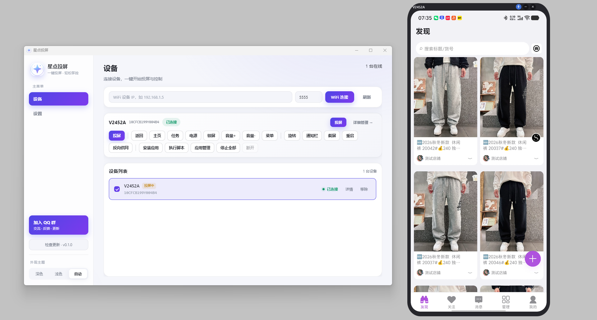

# 写了个开源投屏工具：一个窗口搞定 Android / 鸿蒙投屏，带机型边框



最近花了些时间做了个桌面投屏工具「星点投屏」，已经开源。这篇文章不吹功能清单，主要聊聊实现过程中几个挺有意思的技术问题，以及我是怎么解决的。如果你也在做 Electron 桌面应用或者实时视频渲染，也许能少踩几个坑。

开源地址：
- Gitee：https://gitee.com/zzjnat/star-cast
- GitHub：https://github.com/zhangkalv/star-cast

## 为什么又做一个投屏工具

市面上成熟的方案不少（scrcpy 本身就是标杆）。我想要的其实是一个「开了就能用」的整合体验：设备发现、投屏、控制、机型边框、批量操作都在一个界面里，而且 Android / 鸿蒙双端统一。于是以 scrcpy 等成熟项目为底座，套了一层 Electron + Vue 3 的壳，重点解决端到端的整合体验。

## 几个真正花时间的技术点

### 1. scrcpy 5.x 裸流协议：一个 12 字节的坑

最开始做 Android「单窗口一体投屏」时，画面经常黑屏——不动屏幕就一直黑，切换画面才慢慢恢复。反复排查后发现问题在协议头解析：scrcpy 5.x 的握手包是 81 字节（dummy 1 + 设备名 64 + codecId 4 + sessionHeader 12），而每个数据包前面还有一个 8 字节时间戳 + 4 字节长度的头。

关键坑在于 session packet：它的 flag 位 `bit63=1` 时，后面跟的 8 字节是宽高，不是 payload 长度。我一开始没跳过这 12 字节的 session header，导致后续所有包解析全部错位，解码出来的自然是一片黑。修正为「session 包跳过 12 字节、config 包存 SPS/PPS、media 包拼 Annex-B」之后，画面就稳了。

### 2. WebCodecs 直接喂 Annex-B，不做 avcC 转换

很多 WebCodecs 的 H.264 示例都要求把 SPS/PPS 转成 avcC description 传给 `configure()`。但实测发现，只要每个 chunk 自带 SPS/PPS/IDR，用 `codec: 'avc1.xxx'` 直接喂 Annex-B（带 0001 start code）也能稳定解码：

```js
decoder.configure({ codec, optimizeForLatency: true })
// chunk = 0001 + SPS + 0001 + PPS + 0001 + 各 slice
```

少了一层格式转换，延迟和兼容性反而更好。注意别重复塞 SPS/PPS，关键帧带一次就够。

### 3. Electron 透明窗口的合成层刷新

机型边框用的是无边框透明窗口（CSS 画圆角边框，四角透出桌面）。遇到一个诡异现象：刚启动时画面全黑，切换几次页面才恢复。原因是透明窗口首帧绘制后合成层没刷新。解决办法是首帧后用 `webContents.invalidate()` 配合一次 1px 的位移回原位，强制触发重绘。

还有一个坑：给 `canvas.width/height` 赋值会清空画布，所以只在尺寸真的变化时才赋值。

### 4. Windows 任务栏分组：AppUserModelId

投屏窗口希望能和主窗口分开显示在任务栏。Windows 是按 `System.AppUserModel.ID` 分组的，共用同一个 ID 的窗口会被合并。进程级的 `app.setAppUserModelId()` 不够，得给投屏窗口单独设窗口级 ID：

```js
win.setAppDetails({ appId: 'com.star.cast.player' })
```

这样投屏窗口就有独立的任务栏按钮了。

### 5. 免安装的依赖打包

adb / scrcpy / hdc / gnirehtet 这些工具全部内置到 `resources/bin`，通过 `extraResources` 解包，用户装完不用配环境变量。整个过程写成了 `download-bundled-tools.ps1` 脚本，方便后续升级某个工具。

## 关于鸿蒙投屏

HarmonyOS NEXT 没有 adb，走的是 hosScrcpy 方案——设备端推 `.so` 组件，PC 端经 `hdc fport` 建 gRPC 通道订阅 H.264 流，WebCodecs 解码。这部分要特别说明：hosScrcpy 组件版权归华为，来源于开源项目 hnscrcpy，仅供个人学习研究，商用需自行取得授权。兼容 adb 的鸿蒙机型则直接走 scrcpy 通道。

## 下载与构建

普通用户直接下载安装包双击安装即可（Windows，单个完整 exe）：
- 最新版：https://api.siyushiji.com/fingertip/packages/%E6%98%9F%E7%82%B9%E6%8A%95%E5%B1%8F_Setup_0.1.1.exe

开发者构建：

```bash
npm install
npm run dev        # 开发
npm run dist:win   # 打 Windows 安装包
```

## 写在最后

这个项目是个人兴趣驱动做的，代码以 MIT 开源（第三方二进制组件除外）。如果对你有帮助，欢迎点个 Star；有问题或者想法，也欢迎提 Issue。交流群：https://qm.qq.com/q/mLK9LOpix4
