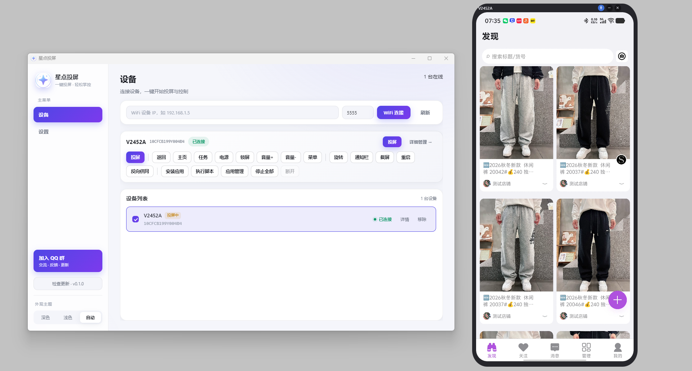

# 星点投屏


支持 **Android / 鸿蒙(HarmonyOS)** 双端的桌面投屏与控制软件，投屏窗口带**手机机型边框**。功能对标 [escrcpy](https://github.com/viarotel-org/escrcpy)。

## 功能

- **多端设备管理**：USB / WiFi 设备发现、连接、备注，双端统一设备卡片
- **投屏控制模式**：镜像、录制视频、录制相机、相机镜像、OTG 模式、灵活启动（自定义 scrcpy 参数）
- **设备交互栏**：返回、主页、任务、电源、音量、旋转屏幕、通知栏、截屏、锁屏、重启、安装应用、文件管理、执行脚本
- **批量处理**：批量截屏、批量安装应用、批量执行脚本、批量计划任务
- **画质控制**：最大尺寸、码率、帧率、编码、方向、裁剪、显示器、缓冲
- **音频控制**：音频源、编码、码率、缓冲、保持设备音频
- **窗口控制**：无边框、全屏、置顶、禁用屏保、窗口尺寸/位置
- **输入控制**：鼠标模式/绑定、键盘模式（含 uhid 中文输入）、手柄
- **摄像控制**：摄像头源、尺寸、朝向、帧率
- **机型边框**：Galaxy / Mate / Pixel 等多款边框样式，投屏窗口外自动加手机外壳
- **主题**：浅色 / 深色 / 跟随系统
- **反向供网**：Gnirehtet（PC → 安卓）

## 双端支持现状

| 能力 | Android | 鸿蒙 |
| --- | --- | --- |
| 设备发现 | adb | hdc |
| 投屏镜像 | scrcpy（全功能） | HarmonyOS NEXT 走 hosScrcpy 原生 H.264 视频流（50–60fps，USB/WiFi 均可），失败时回退 hdc 截屏流；兼容 adb 的鸿蒙设备走 scrcpy |
| 远程控制 | adb | hdc |
| 截屏 / 文件 | adb | hdc |

## 快速开始

```bash
npm install
npm run dev        # 开发（或双击 启动星点投屏.bat，日志写入 dev.log）
npm run build      # 产物输出 out/
npm run dist:win   # 打包 Windows 安装包
```

## 外部二进制依赖（已全部内置）

项目已通过 `scripts/download-bundled-tools.ps1` 把所需工具内置到 `resources/bin/win32/`：

| 工具 | 用途 | 内置情况 |
| --- | --- | --- |
| adb (platform-tools 37.0.1) | Android 设备发现/控制 | ✅ |
| scrcpy 5.0.1 | Android 投屏 | ✅ |
| hdc 3.2.0d | 鸿蒙设备 | ✅ |
| gnirehtet 2.5.1 | 反向供网 | ✅ |

打包时 `resources/bin` 通过 extraResources 解包释放（不进 asar），用户**安装完即可用**。如需升级某个工具：

```powershell
.\scripts\download-bundled-tools.ps1 -Only adb   # 或 scrcpy / gnirehtet / hdc
```

个别工具仍可在「设置 → 通用」指定绝对路径覆盖内置版本。

### 鸿蒙投屏组件（hosScrcpy）

HarmonyOS NEXT 无 adb，投屏走华为 hosScrcpy 方案：设备端推送 `resources/hos/so/*.z.so` 并由 `uitest start-daemon` 拉起，PC 端经 `hdc fport` 建立 gRPC 通道订阅 H.264 视频流，渲染端用 WebCodecs 解码。整套通道零新增 npm 依赖（手写 HTTP/2 gRPC + protobuf 编解码）。

> **版权与授权**：`resources/hos/hosScrcpy.jar` 及其中解出的 `.so` 组件版权归华为所有，来源于开源项目 [hnscrcpy](https://github.com/taxiao213/hnscrcpy)（Apache-2.0，但其内置的 hosScrcpy jar / hdc 二进制不在该授权内）。该项目声明仅供个人学习研究、禁止商用；商用需自行向华为取得授权。本项目集成这部分仅用于个人/学习用途。

## 配置与日志

- 配置：`%APPDATA%\star-record\config.json`
- 日志：`%APPDATA%\star-record\logs\main.log`（开发日志 `dev.log`）

⚠️ 手工修改 `config.json` 前必须**彻底退出应用**——渲染进程（Pinia）旧内存状态会在下次保存时覆盖你的修改。推荐用 `scripts/restart-with-config.ps1` 一键「关进程 → 写配置 → 重启」。

## 架构

```
electron-vite + Vue 3 + Pinia
├─ src/main            主进程：adb/hdc 工具调用、scrcpy 会话、任务调度
│  ├─ services/        adb / hdc / scrcpy / gnirehtet / device-manager
│  └─ windows/         主窗口 / 机型边框窗口（frame:get-payload 拉取式）/ 浮动控制栏
├─ src/preload         contextBridge 安全桥
├─ src/renderer        Vue 界面（首页 / 设备详情 / 批量任务 / 设置）
└─ resources/          边框窗口、浮动控制栏静态页面；bin/ 放外部二进制
```

机型边框窗口采用「页面主动拉取 `frame:get-payload` + dom-ready + 延时兜底」三重机制，避免 did-finish-load 事件不触发导致边框不显示的问题。

## 下载安装（Windows）

普通用户无需配置开发环境，直接下载安装包双击安装即可：

- **最新版下载（单个完整 exe，推荐）**：[星点投屏 Setup 0.1.1.exe](https://api.siyushiji.com/fingertip/packages/%E6%98%9F%E7%82%B9%E6%8A%95%E5%B1%8F_Setup_0.1.1.exe)

内置 adb / scrcpy / hdc 等工具，**装完即可用**，无需另外配置环境变量。首次用 USB 投屏需在手机上开启「开发者选项 → USB 调试」。

开发者构建见上方「快速开始」。

## 社区

- QQ 群：https://qm.qq.com/q/mLK9LOpix4
- 问题反馈：欢迎在 Gitee / GitHub 提 Issue。

## 许可证

本项目**自有源代码**采用 [MIT License](LICENSE)。

第三方组件各有其许可，`resources/bin`、`resources/hos` 下的二进制（adb、scrcpy、hdc、gnirehtet、hosScrcpy 等）版权归各自上游所有，详见对应目录的 LICENSE / NOTICE 文件。其中 hosScrcpy 相关组件版权归华为，来源于 [hnscrcpy](https://github.com/taxiao213/hnscrcpy)，**仅供个人学习与研究，禁止商用**；商用请自行向上游取得授权。

本项目按「现状」提供，不作任何明示或暗示保证。因使用本项目造成的任何损失，作者不承担责任。